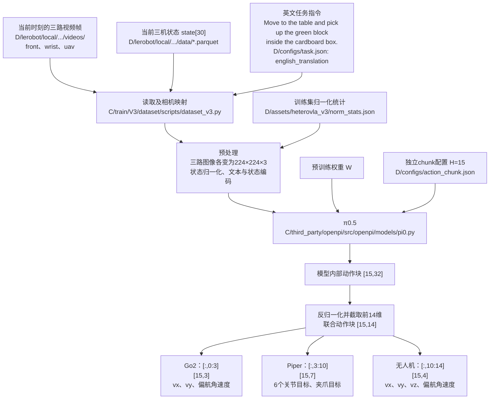

# HeteroVLA 数据结构与 π0.5 输入输出

当前入口：`/meta_eon_cfs/home/hph/heterovla-data/V3`，指向`aligned/V3`。保留55条训练示教，7条验证示教；15Hz，action chunk为15步。旧V2数据及其变体已按用户要求清理。

本次合并10月20日、21日共24条录制：10月20日task_11、task_13、task_14、task_15加入验证，其余20条加入训练。原有3条验证录制从原始审计表重建。训练和验证均不补值，只使用有效连续片段。

## 数据文件树

```text
/meta_eon_cfs/home/hph/heterovla-data/
├── raw/benchmark/                          # 原始记录，保持原样
├── V3 -> aligned/V3/
└── aligned/V3/
    ├── lerobot/local/
    │   ├── heterovla_v3_train/        # 55条来源，45,997帧
    │   │   ├── data/chunk-000/            # 856个Parquet，000000～000855
    │   │   ├── videos/chunk-000/
    │   │   │   ├── observation.images.front/ # 856个MP4
    │   │   │   ├── observation.images.wrist/ # 856个MP4
    │   │   │   └── observation.images.uav/   # 856个MP4
    │   │   └── meta/                     # info、tasks、episodes、episodes_stats
    │   └── heterovla_v3_val/          # 7条来源，4,257帧
    │       ├── data/chunk-000/            # 251个Parquet，000000～000250
    │       ├── videos/chunk-000/          # 三个相机各251个MP4，共753个
    │       └── meta/                     # 同上4个元数据文件
    ├── configs/
    │   ├── action_chunk.json             # action_horizon: 15
    │   ├── imputation.json               # 训练与验证均不补值
    │   ├── schema.json
    │   ├── source_inventory.json
    │   └── task.json                     # 含英文prompt
    ├── assets/heterovla_v3/norm_stats.json # 新训练集统计
    ├── aligned/                          # 64个未补值的来源审计表
    ├── provenance/                       # 1,107个片段溯源表
    ├── reports/                          # 检查报告及逐来源统计
    │   ├── sources/                      # 64条来源报告
    │   └── history/                      # 迁移前检查证据
    ├── scripts/                          # 代码快照
    ├── README.md
    ├── STATUS.json
    └── SHA256SUMS.txt
```

训练集有34,013个H15窗口，验证集有743个。窗口保持1/15秒步长，不跨来源或记录缺口；两侧均按原始有效连续片段读取。审计中另保留1条历史隔离来源和1条没有可用片段的来源，它们不进入训练或验证。

## 模型输入输出

下图按单样本表示；批量训练时，张量最前面增加batch维度B。

```text
D = /meta_eon_cfs/home/hph/heterovla-data/V3
C = /meta_eon_cfs/home/hph/heterovla
W = /meta_eon_cfs/home/hph/heterovla-model/pretrained/pi05_base/params
```



| 数据相机 | π0.5输入字段 | 原始图像 | 模型图像 |
|---|---|---|---|
| front | `image.base_0_rgb` | 480×640×3 | 224×224×3 |
| wrist | `image.left_wrist_0_rgb` | 480×640×3 | 224×224×3 |
| uav | `image.right_wrist_0_rgb` | 480×640×3 | 224×224×3 |

无人机使用`right_wrist_0_rgb`这个相机槽位，该名称不表示相机实际安装在右腕。30维状态由Go2的10维、Piper的7维、无人机的13维组成。当前π0.5配置会把归一化后的状态离散编码进文本token；输入结构同时保留补齐到32维的state字段，文本token最大长度为200。

32是当前openpi π0.5预训练权重的动作接口维度，不是整个模型的隐藏维度，也不是三台设备实际有32个动作自由度。配置中的`action_dim=32`与checkpoint相匹配：动作输入投影权重为`[32,1024]`，输出投影权重为`[1024,32]`，当前动作专家的隐藏宽度是1024。本任务的14维动作归一化后在末尾补18个零，模型输出经反归一化后保留前14维。`action_dim`在代码中可以配置，但直接改成14会使这些预训练投影层的形状不匹配，需要另行处理权重。chunk长度15与通道维度32是两个独立参数。

任务文本由loader读取`D/configs/task.json`中的`english_translation`，当前为`Move to the table and pick up the green block inside the cardboard box.`。LeRobot `task`中文元数据统一为configs/task.json中的instruction，旧任务文字保存在合并历史报告中；送入模型的`prompt`使用英文。该映射要求配置声明所有记录属于同一任务且原生任务表只有一个任务；缺失翻译或多任务数据会报错，避免误用一条统一指令。`prompt_from_task=False`表示不让openpi用原始任务文本覆盖loader已经提供的英文prompt。部署时也应提供对应的英文指令。

训练时，样本额外提供未来动作标签`[15,14]`，归一化并补齐为`[15,32]`参与监督。推理输出经反归一化、裁剪后为`[15,14]`，每一行包含同一时间步的三机动作。

Go2和无人机的标签是随后1/15秒实际位姿变化对应的运动速度代理；Piper标签是截至该区间终点最近的有效已发送绝对关节及夹爪目标。跨设备物理曝光同步精度仍未独立测定。

预测15步不要求一次执行完15步。例如可以执行前3步，即0.2秒后利用新观测重新预测；实际执行步数由执行端另行确定。

## 代码和模型路径

| 用途 | 路径 |
|---|---|
| 数据入口 | `/meta_eon_cfs/home/hph/heterovla-data/V3` |
| chunk配置 | `/meta_eon_cfs/home/hph/heterovla-data/V3/configs/action_chunk.json` |
| 数据loader | `/meta_eon_cfs/home/hph/heterovla/train/V3/dataset/scripts/dataset_v3.py` |
| chunk参数解析 | `/meta_eon_cfs/home/hph/heterovla/train/V3/dataset/scripts/chunk_settings.py` |
| π0.5配置工厂 | `/meta_eon_cfs/home/hph/heterovla/train/V3/dataset/scripts/pi05_config.py` |
| π0.5模型实现 | `/meta_eon_cfs/home/hph/heterovla/third_party/openpi/src/openpi/models/pi0.py` |
| 预训练权重 | `/meta_eon_cfs/home/hph/heterovla-model/pretrained/pi05_base/params` |

训练时配置的checkpoint输出位置如下。当前尚未启动这套新配置的训练，因此该输出尚未生成。

```text
/meta_eon_cfs/home/hph/heterovla-model/V3/checkpoints/
└── pi05_heterovla_v3_full/
    └── <运行名称>/
```

动作预测本身是内存中的`[15,14]`张量，当前没有额外配置动作预测文件的自动落盘目录。

## 验证集：原始有效片段，不补值

验证集所有导出状态与动作均来自原始有效记录；不沿用前值，不使用占位0作为标签。遇到无效时间点切段，每段至少15帧，训练窗口在段内生成。

| 来源 | 验证帧数 | 连续片段数 | 15步窗口 |
|---|---:|---:|---:|
| 2026-10-13/task_12_1333-1430 | 640 | 37 | 122 |
| 2026-10-13/task_13_1509-1606 | 557 | 33 | 95 |
| 2026-10-15/task_04_1557-1648 | 550 | 32 | 102 |
| 2026-10-20/task_11_0421-0518 | 560 | 33 | 98 |
| 2026-10-20/task_13_0718-0827 | 704 | 42 | 116 |
| 2026-10-20/task_14_0919-1021 | 592 | 35 | 102 |
| 2026-10-20/task_15_1052-1154 | 654 | 39 | 108 |

`aligned/`保留未补值审计数据，可能存在带无效标记的0占位。训练与验证loader读取`lerobot/`中的有效数据；`provenance/`记录每一帧对应的原始时间点和有效性。当前原生验证数据不再包含state_imputed或action_imputed字段。

原有验证任务中的command_sent=0等无效记录按规则排除，不再构造保持目标。任务中的无效片段并不等同于文件损坏。

训练与验证按录制任务划分，不含重复来源任务，但仍有采集会话重叠；不是采集会话独立验证。具体会话见configs/source_inventory.json与reports/validation.json。归一化仅使用45,997帧训练数据。

本次核对全部导出表格、全量解码导出视频，并抽样对照原始图像；10月20日02相机修复帧保留并单独核对。模型默认chunk、英文prompt和实际loader边界检查均有报告。本次只更新数据与配置，未启动训练。合并前数据与独立批次归档于heterovla-data/archive/，原始录制保持原样。
