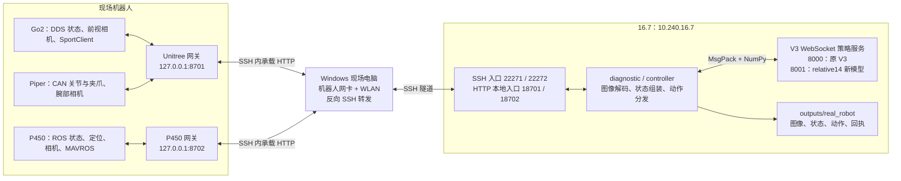
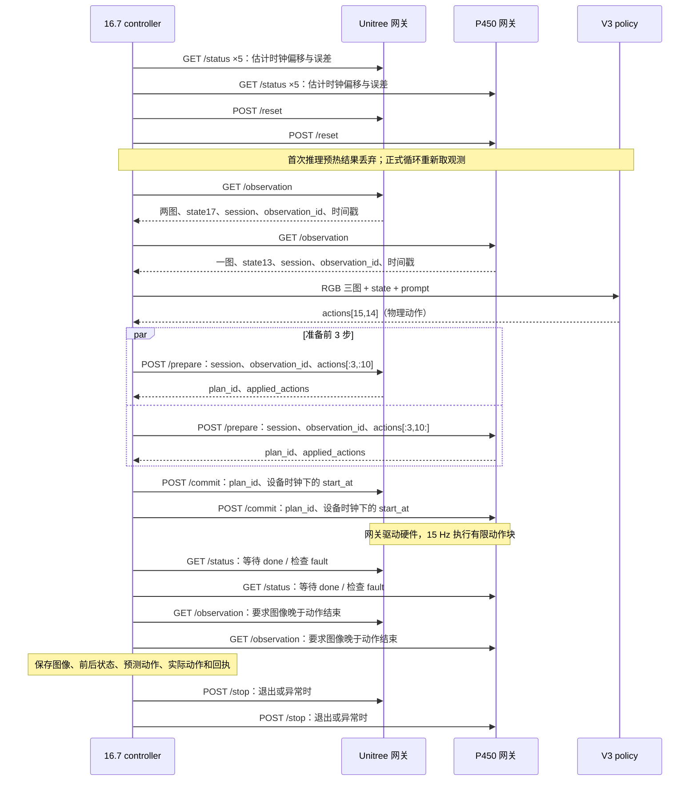

# 16.7 ↔ Go2 / Piper / P450 真机推理流程

联调日期：2026-10-24。主机：`10.240.16.7`。项目目录：`/meta_eon_cfs/home/yhy/heterovla`。

本文记录当天实际验证结果、网络拓扑、数据协议，以及下一次启动和调用顺序。命令默认在 16.7 的项目根目录执行；Windows 和机器人端命令会单独标注。运行入口的完整说明见 [真机 README](README.md)。

## 1. 今天完成了什么

已完成真实数据链路：**Go2 前视图 + Piper 腕部图 + P450 图像 + 30 维状态 → 16.7 V3 模型 → `(15,14)` 动作返回并保存**。两轮共 4 次只读诊断均成功，三路图像均为 640×480，动作全部为有限数值。

| 项目 | 当天结果 |
| --- | --- |
| 模型推理耗时 | 96.13、100.81、120.18、125.38 ms |
| 两端观测请求耗时 | 275.40–587.41 ms；包含请求、取数与返回，不是单独的网络 RTT |
| 真实动作下发 | **未执行**；以上诊断没有 `/prepare`、`/commit` 路径 |
| Go2 | 未站立，DDS 报 `error_code=1001` |
| P450 | connected=true、armed=false、odom_valid=true，MANUAL，landed_state=1 |
| 控制时序 | 未验收；此前测得 RTT 约 182–387 ms，超过现有执行时钟误差要求 |
| P450 时间 | 修复了 1970 年系统时间；修复后位姿时间戳与 4 次推理通过；rtc0 写入读回成功，rtc1 重启持久化未验证 |

因此，下次优先复现的是“观测与推理”。“动作下发 → 执行回执 → 执行后图像”已有代码及本地模拟测试，仍需现场实机验收。模型输出动作也不等于已完成“拿取纸箱内绿色方块”。

当天证据：

- [联调汇总 JSON](../../.cache/real_robot/real_interface_check.json)
- [第一轮诊断](../../outputs/real_robot/20261024_141645_diagnostic/)、[第二轮诊断](../../outputs/real_robot/20261024_141807_diagnostic/)
- [三路图像预览](../../outputs/real_robot/20261024_141643/index.html)

15:58 追加验证：恢复 P450 HTTP 转发后，两轮真实模型动作已发送到机载只观测校验接口，Unitree 收到 `(3,10)`、P450 收到 `(3,4)`，逐值回传一致，两端均取回回执之后的新图像。没有调用硬件执行。P450 动作数值/速度检查通过；Piper 首步目标与实测关节角差超过 0.35 rad，因此 Unitree 动作校验拒绝。新增结果见 [动作下行汇总](../../.cache/real_robot/action_downlink_check.json) 和 [两轮完整记录](../../outputs/real_robot/20261024_155818_diagnostic/)。这两轮不计入上表最初的 4 次推理统计。

## 2. 框架图与端口

三类机器人对应两个机载网关：Go2 和 Piper 共用 Unitree 机载电脑；P450 单独一个网关。Windows 负责现场网络与 SSH 转发，模型和协调控制器都运行在 16.7。



| 用途 | 16.7 入口 | 实际目标 |
| --- | --- | --- |
| Unitree SSH | `127.0.0.1:22271` | Windows → `192.168.123.18:22`，用户 `unitree` |
| P450 SSH | `127.0.0.1:22272` | Windows → `192.168.1.11:22`，用户 `amov` |
| Unitree HTTP | `127.0.0.1:18701` | 经上述 SSH → Unitree `127.0.0.1:8701` |
| P450 HTTP | `127.0.0.1:18702` | 经上述 SSH → P450 `127.0.0.1:8702` |
| 原 V3 策略 | `ws://127.0.0.1:8000` | 16.7 上的 GPU 推理服务 |
| 新 relative14 策略 | `ws://127.0.0.1:8001` | 训练出新 checkpoint 后另行启动 |

这里的 `127.0.0.1` 是对应机器的回环地址，只限制这些服务的监听范围，**不表示 16.7 禁止其他网络访问**。Windows 的 `-R` 先解决 16.7 如何访问现场 SSH；16.7 的 `-L` 再解决协调器如何访问机载 HTTP。策略服务无须暴露给 Windows 或机器人。

## 3. 收什么、发什么

### 3.1 机器人 → 16.7：真实观测

机载网关通过带 Bearer token 的 HTTP JSON 返回 JPEG/Base64 图像、状态值、时间戳与健康信息。16.7 解码 JPEG、转换 BGR→RGB，再组装 OpenPI 输入。

| 来源 | 图像文件名 | 模型图像键 | 状态数 |
| --- | --- | --- | --- |
| Go2 / Unitree | `front.jpg` | `base_0_rgb` | Go2 10 维 |
| Piper / Unitree | `wrist.jpg` | `left_wrist_0_rgb` | Piper 7 维 |
| P450 | `uav.jpg` | `right_wrist_0_rgb` | P450 13 维 |

模型图像键沿用训练槽位名，`right_wrist_0_rgb` 在本项目表示无人机相机。

原 V3 的 state30 顺序如下，索引从 0 开始：

| 索引 | 含义 |
| --- | --- |
| 0–9 | Go2：相对本次观测起点的 x/y、机身高度、roll/pitch、相对 yaw 的 sin/cos、航向系 vx/vy、yaw_rate |
| 10–16 | Piper：六个实测关节角 q1…q6（rad）、实测夹爪开度（m） |
| 17–29 | P450：相对起点 x/y、本地 z、roll/pitch、相对 yaw 的 sin/cos、航向系 vx/vy、vz、yaw_rate、armed、landed_state |

`/reset` 重置本次观测参考原点与会话，不是机械臂回零或机器人复位。线速度、偏航角速度由观测历史估计；它们不是直接把上次下发的命令作为当前状态。图像和状态时间戳会参与新鲜度检查，软件不能保证独立相机的曝光物理同步。

### 3.2 16.7 → 模型 → 16.7：请求与返回

请求结构：

```python
observation = {
    "image": {                 # RGB uint8，真实输入每路 480×640×3
        "base_0_rgb": front_rgb,
        "left_wrist_0_rgb": wrist_rgb,
        "right_wrist_0_rgb": uav_rgb,
    },
    "image_mask": {key: True for key in image_keys},
    "state": state,            # 原 V3 为 float32[30]；relative14 为 [14]
    "prompt": "Move to the table and pick up the green block inside the cardboard box.",
}
# WebSocket 二进制 MsgPack/NumPy 编码；返回 response["actions"]：float[15,14]
```

以上是字段示意；实际编码和调用由 [controller.py](controller.py) 的 `Policy` 处理。任务以后修改 [controller.json](config/controller.json) 的 `prompt`；使用新模型时修改 [controller_relative14.json](config/controller_relative14.json)。

### 3.3 16.7 → 机器人：14 维物理动作

| 动作索引 | 执行端 | 含义与单位 |
| --- | --- | --- |
| 0–2 | Go2 | 航向系 vx、vy（m/s）、yaw_rate（rad/s） |
| 3–8 | Piper | 六个绝对关节目标角（rad） |
| 9 | Piper | 绝对夹爪目标开度（m） |
| 10–13 | P450 | 航向系 vx、vy、vz（m/s）、yaw_rate（rad/s） |

协调器按 `actions[:steps, :10]` 发给 Unitree，按 `actions[:steps, 10:]` 发给 P450。默认 `steps=3`，模型预测 15 步，但每轮只执行前 3 步，每步 `1/15 s`，然后重新观测与预测。

网关默认将速度乘 0.3 并限幅，Piper 还检查关节范围和变化率。Unitree 调用 Go2 SportClient 与 Piper SDK；P450 将航向系水平速度按当前 yaw 转成世界系分量，通过 `/uav1/mavros/setpoint_velocity/cmd_vel` 发布 `TwistStamped`。日志里的 `predicted_actions` 与 `applied_actions` 分别对应预测值和网关实际采用的值。

### 3.4 原 V3 与 relative14 的区别

| 项目 | 今天实测的原 V3 | 新 relative14 |
| --- | --- | --- |
| 配置 / 端口 | `controller.json` / 8000 | `controller_relative14.json` / 8001 |
| 输入状态 | 30 维 | 从原 30 维选择对应动作的 14 维 |
| 模型训练动作 | 物理关节目标与速度 | 非夹爪通道减去同一动作块起点 state；夹爪保持绝对值 |
| API 返回 | 物理动作 `(15,14)` | 服务端反归一化并加回块起点后，返回物理动作 `(15,14)` |
| 可用权重 | 今天使用的旧 V3 checkpoint | 需要新训练产生、带 relative14 语义标记的 checkpoint |

新输入的 state30 零起始索引为 `[7,8,9,10,11,12,13,14,15,16,24,25,26,27]`。客户端根据策略元数据自动选择，不需要机载网关丢弃其他状态。相对速度不是加速度，也不逐步积分；**执行端不能再次加 state**。新旧 checkpoint 不能混用，见 [relative14 说明](../../train/V3/relative14/README.md)。

## 4. 下次调用：按顺序恢复观测与推理

### 第一步：Windows 接通现场网络并建立反向隧道

现场有线地址：Unitree 网卡“以太网 4”是 `192.168.123.51`；P450 网卡“以太网 5”是 `192.168.1.123`。WLAN 保持访问服务器。

在 Windows PowerShell 执行：

```powershell
Get-NetAdapter -Name "以太网 4","以太网 5" | Format-Table Name,Status
Test-NetConnection 192.168.123.18 -Port 22
Test-NetConnection 192.168.1.11 -Port 22

# 两个 TcpTestSucceeded 均为 True 后执行，并保持此窗口打开：
ssh -NT -o ExitOnForwardFailure=yes -o ServerAliveInterval=15 -o ServerAliveCountMax=3 -R 127.0.0.1:22271:192.168.123.18:22 -R 127.0.0.1:22272:192.168.1.11:22 16.7
```

`16.7` 使用 Windows 已有 SSH 别名（`HostName 10.240.16.7`、`User root`、`ProxyJump h102`）。`-NT` 认证后没有命令提示符是正常转发状态。若提示端口占用，先检查已有隧道，不重复建立。当天确认可用的 Unitree 地址是 `192.168.123.18`，不是此前尝试的 `192.168.0.147`。

### 第二步：16.7 检查 SSH 和已有网关

```bash
cd /meta_eon_cfs/home/yhy/heterovla
source env.sh
python -m real_robot.manage probe
python -m real_robot.manage status
```

SSH 别名 `v3-unitree`、`v3-p450` 来自 `.cache/real_robot/ssh_config`；私钥路径为 `/meta_eon_cfs/home/yhy/heterovla/h100_hph`。本机 `.cache/real_robot/token` 与机载 `~/.config/heterovla-live/token` 用于 HTTP 认证。复用现有配置，文档不保存密钥或密码。

已部署且只观测网关仍运行时直接复用。冷启动先完成第三步的 ROS、观测栈与相机准备，再启动网关。只需操作一端时附加 `--kind unitree` 或 `--kind p450`。若上次为执行模式，先完成现场控制交接，再停止该网关。

只有代码更新或新部署才执行以下分支，日常复用不必重打包：

```bash
python -m real_robot.manage stop
python -m real_robot.manage pack
python -m real_robot.manage deploy
```

部署位置是两台机载电脑的 `~/heterovla-live`。Unitree 部署会编译桥接程序；网关配置见 [unitree.json](config/unitree.json) 和 [p450.json](config/p450.json)。

### 第三步：确认 P450 观测栈和相机

本包 `sensors-start` 先查询 ROS master，冷启动时需要 master 已可用。在 P450 终端（16.7 可用 `ssh -F .cache/real_robot/ssh_config v3-p450` 登录）检查 `rosnode list`；若确实没有 ROS master，在独立 P450 终端执行并保持运行：

```bash
# 此段在 P450 执行，仅 ROS master 未运行时使用：
source /opt/ros/noetic/setup.bash
source /home/amov/p450_experiment/devel/setup.bash
roscore
```

回到 16.7：

```bash
python -m real_robot.manage sensors-status --kind p450
# 仅观测栈未运行时启动：
python -m real_robot.manage sensors-start --kind p450
```

首次构建或观测栈代码更新时先运行 `python -m real_robot.manage sensors-build --kind p450`。该栈使用已有 ROS Noetic 工作空间，包含 MAVROS、MID360、FAST-LIO 和估计器；它不加载 UAV_controller，不自动解锁、起飞或切换模式。

RGB 相机是独立 roslaunch，不由 `sensors-start` 启动。当天的启动参数和 PID 记录在 P450 的 `~/heterovla-live/camera_process.json`，日志是 `camera.log`。重启后需要按该记录恢复相机，不能仅凭观测栈 started 判定图像可用。可从 16.7 检查：

```bash
ssh -F .cache/real_robot/ssh_config v3-p450 'cat ~/heterovla-live/camera_process.json; tail -30 ~/heterovla-live/camera.log'
ssh -F .cache/real_robot/ssh_config v3-p450 'bash -lc '\''source /opt/ros/noetic/setup.bash && source /home/amov/p450_experiment/devel/setup.bash && timeout 8 rostopic hz /uav1/camera/color/image_raw/compressed'\'''
```

若重启后相机进程已消失，确认没有另一个相机驱动占用设备后，在 **P450 终端** 按已记录的参数恢复，并更新 PID 记录供后续校时脚本使用：

```bash
source /opt/ros/noetic/setup.bash
source /home/amov/p450_experiment/devel/setup.bash
cd ~/heterovla-live
/usr/bin/python3 - <<'PY'
import json
import subprocess
import time
from pathlib import Path
from real_robot.service import identity

record = Path('camera_process.json')
old = json.loads(record.read_text())
# PID 仍存在时先人工核查，避免重复占用相机或误判 PID 复用。
if identity(old['pid']) is not None:
    raise RuntimeError('Recorded PID still exists; inspect it before restarting camera')
command = old['command']
if not any(Path(arg).name == 'roslaunch' for arg in command):
    raise RuntimeError('Expected the previously recorded roslaunch command')
with Path('camera.log').open('ab', buffering=0) as log:
    child = subprocess.Popen(command, stdin=subprocess.DEVNULL, stdout=log,
                             stderr=log, start_new_session=True)
time.sleep(1)
if child.poll() is not None:
    raise RuntimeError('Camera exited; inspect camera.log')
record.write_text(json.dumps({'pid': child.pid, 'command': command}, indent=2) + '\n')
print('Camera started:', child.pid)
PY
```

此恢复段依赖当天保留的 `camera_process.json`；记录缺失时需重新核对相机 launch 参数。启动后仍需通过图像话题和三图预览确认数据。

ROS 和传感器就绪后，在 **16.7** 启动尚未运行的网关：

```bash
python -m real_robot.manage start
python -m real_robot.manage status
```

`start` 默认只观测。网关已运行时不要重复启动；只有一端停止时用 `--kind unitree` 或 `--kind p450` 指定该端。

若 P450 再次出现 1970 年、ROS 源时间戳在未来或过旧，在无人机未解锁、观测已按脚本要求交接时运行：

```bash
bash inference/scripts/repair_p450_clock.sh
```

脚本交互读取 sudo 密码，停止并恢复本包观测进程及已核对的相机进程。它修复系统时间，不保证断电后的 RTC/NTP 持久化。修复后重新检查图像、位姿与完整诊断。

### 第四步：16.7 两个终端分别转发 HTTP 网关

终端 A：

```bash
cd /meta_eon_cfs/home/yhy/heterovla
source env.sh
python -m real_robot.manage tunnel --kind unitree
```

终端 B：

```bash
cd /meta_eon_cfs/home/yhy/heterovla
source env.sh
python -m real_robot.manage tunnel --kind p450
```

两个窗口保持运行，分别提供 `127.0.0.1:18701`、`127.0.0.1:18702`；已有转发可复用。

### 第五步：确认策略服务

终端 C，先检查原 V3 服务。此命令只使用本地验证集样本，不连接机器人：

```bash
source env.sh
python inference/scripts/check_v3_policy.py --host 127.0.0.1 --port 8000
```

已有服务正常就复用。服务不存在且已确认有可供推理的 GPU 时，在独立终端启动；下面 `0` 是示例 GPU 编号，需替换为实际分配的卡：

```bash
source env.sh
python train/V3/local_yhy/serve_policy.py --gpu 0 --host 127.0.0.1 --port 8000
```

原服务默认加载：

```text
/meta_eon_cfs/home/yhy/heterovla-model/V3/checkpoints/pi05_heterovla_v3_vitlora/
vitlora_r8_a16_dense_b32_lr1e-5_ema099_h15_s42_data20261021_fresh2/19999
```

`server listening on 127.0.0.1:8000` 只说明 WebSocket 服务监听成功，不说明现场隧道、观测或执行已经可用。首次模型请求可能编译，耗时会明显高于热推理。

### 第六步：先看图，再复现今天的真实输入推理

```bash
source env.sh
# 三路图像预览，不调用模型：
python -m real_robot.controller --config inference/real_robot/config/controller.json --token-file .cache/real_robot/token --observe --cycles 10

# 真实三图 + state30 → 模型 → 动作文件；不下发动作：
python -m real_robot.diagnostic --config inference/real_robot/config/controller.json --token-file .cache/real_robot/token --cycles 2
```

两端网关都必须为只观测模式。诊断允许记录地面、未解锁等真实状态及就绪问题，不伪造 armed，不生成可执行的 `observation_id`。它仍要求三张图和真实状态可读；成功标准是返回有限 `(15,14)` 动作，日志中 `executed=false`。`synchronized_for_execution=false` 是明确的验收范围，并非控制时序已经通过。

### 第七步：动作发到真机网关并回传，不驱动硬件

两端已于当天部署 `validate_actions_v1` 接口。继续执行：

```bash
python -m real_robot.diagnostic --config inference/real_robot/config/controller.json --token-file .cache/real_robot/token --validate-actions --cycles 2
```

流程为：真实观测 → 模型 `(15,14)` → 截取前 3 步 → 两端 `POST /validate_actions` → 数值校验回执 → 重新采集三图。请求包含唯一 `request_id` 和对应端的 `actions`；回执含 `received_actions`、`received_at`、`validation_passed`、`candidate_actions` 或拒绝原因。客户端核对数值和请求 ID，并要求新图的设备采集时间晚于各自网关接收时间。

此接口仅允许只观测网关，不调用 `send/hold/halt/check_execution`，不创建执行计划、不返回 plan_id，也不能将回执用于 `/commit`。网关回执的 `executed=false`、`executable=false` 始终为真。它使用真实状态检查动作数值、限幅和初始关节差，但不验证完整执行资格；`received=true` 与 `validation_passed=true` 是两件不同的事。`candidate_actions` 是仅计算得到的候选值，没有发送给硬件。

每轮保存 `downlink_<轮次>.json`，完整结果加入 `cycles.jsonl`。`latest/` 保存校验回执之后的新图像，不是“运动之后”的图像。当天两轮下行成功，但 Unitree 因 Piper 首步差值超限拒绝校验；应检查当前姿态与预测目标，不能把限幅检查关闭后执行。

## 5. 实际下发动作时的调用流程

以下是后续实机验收流程，今天没有执行。先解决 Go2 错误及站立状态、Piper 使能与 CAN 反馈、P450 的飞行状态和控制权交接，以及网络时序。P450 执行要求现场已准备为 connected/armed/OFFBOARD/空中，定位有效；程序不代替现场起飞准备。

执行路径时序：



代码入口先后为：

```text
controller.main()
  Device.calibrate() → /status
  parallel('/reset')
  Policy(...) → WebSocket 元数据检查
  run_cycle(execute=False, cycle=-1) → 预热并丢弃
  run_cycle(execute=True)
    decode_observation() → 图像、状态、时序检查
    Policy.infer() → 根据元数据选择 state30/state14，获取物理动作
    /prepare → Gateway.prepare() → 就绪、限幅、凭据与时效检查
    /commit → Gateway.commit() / _run()
      UnitreeHardware.send() → Piper SDK + Go2 SportClient
      P450Hardware.send() / _publish() → MAVROS 速度话题
    /status → 完成回执
    /observation → 动作结束后的新图像
  finally: stop_all() → /stop
```

现场条件和时序检查满足后，调用：

```bash
# 切换到执行网关；P450 此模式会建立速度发布器并持续发布保持流。
# 此步骤已涉及控制输出，必须先完成现场控制权交接。
python -m real_robot.manage stop
python -m real_robot.manage start --execute

# 单轮：预测 15 步，默认只执行前 3 步，再获取执行后图像：
python -m real_robot.controller --config inference/real_robot/config/controller.json --token-file .cache/real_robot/token --execute --cycles 1
```

不用 `--execute` 的普通 controller 会走严格观测、时钟和预热路径，但不执行 prepare/commit；现场尚未就绪时，应使用上一节的 `diagnostic`。

现有执行检查包括：单端时钟误差 ≤40 ms、两端误差合计 ≤40 ms、输入观测新鲜度、动作年龄 ≤0.75 s、实际跨设备启动偏差含误差 ≤50 ms；P450 高度 0.3–2.0 m、距本次起点水平半径 ≤1 m。检测到其他 MAVROS 指令发布者会拒绝控制。今天链路尚不满足执行时序，不应通过放宽这些检查来把诊断成功当成执行验收。

退出 controller 会请求两端停止；本包网关也有超时处理。软件停止依赖网络、机载程序和飞控正常，不能代替现场硬件急停。结束本次控制并交接后，可停止本包网关：

```bash
python -m real_robot.manage stop
```

## 6. 图像、动作与日志在哪里

| 路径 | 内容 |
| --- | --- |
| `outputs/real_robot/<时间>/index.html` | controller 生成的静态三图预览页 |
| `outputs/real_robot/<时间>[_diagnostic]/latest/{front,wrist,uav}.jpg` | 最新真实三图；执行成功时为动作结束后的新图 |
| `latest/observation.json` | 图像之外的观测元数据、状态与健康信息 |
| `latest/actions.json` | 最新动作及本轮状态 |
| `cycles.jsonl` | 各轮动作与时延；执行模式还含实际动作及前后观测元数据、回执 |
| `downlink_000.json` 等 | `--validate-actions` 每轮的非执行动作接收回执；动作被拒绝也保留原因 |
| `stop.json` | 执行 controller 退出时的停止请求结果 |
| 机器人 `~/heterovla-live/gateway.log` | 网关启动、观测与执行错误 |
| P450 `~/heterovla-live/p450_sensors.log`、`camera.log` | 观测栈与独立相机日志 |

`latest` 每轮覆盖，只保留最新图像；`cycles.jsonl` 逐轮追加数据，但不保存每一轮完整图像。诊断目录没有 controller 的 `index.html`，可直接查看 JPG 和 JSON。

## 7. 新 relative14 模型训练好以后如何切换

先通过监听状态或训练日志确认有新 checkpoint，再填写真实路径。训练监听与推理服务是独立进程，监听器不会自动部署新推理服务：

```bash
source env.sh
python -m train.V3.relative14.watch_gpu status

# 将 /path/to/new/checkpoint/19999 替换为已生成的 relative14 checkpoint：
python -m train.V3.relative14.serve_policy --checkpoint /path/to/new/checkpoint/19999 --check-only
python -m train.V3.relative14.serve_policy --checkpoint /path/to/new/checkpoint/19999 --gpu 0 --port 8001
```

另开终端验证，然后保持机载网关为只观测模式做真图诊断：

```bash
source env.sh
python -m train.V3.relative14.check_policy --url ws://127.0.0.1:8001
python -m real_robot.diagnostic --config inference/real_robot/config/controller_relative14.json --token-file .cache/real_robot/token --cycles 2
```

新服务根据新归一化资产恢复物理动作，因此真机执行器仍接受同样的 14 维物理指令。旧 V3 checkpoint 即使参数形状相容，也不能拿来模拟 relative14 权重。

## 8. 常见现象与定位

| 现象 | 检查位置 |
| --- | --- |
| Windows SSH 登录后没有输出 | `-NT` 正常表现；另开窗口检查连接，保留转发窗口 |
| `Test-NetConnection` 从 WLAN 发出并超时 | 机器人网卡是否 Up、IP/网段是否正确、网线和设备是否上电 |
| 16.7 SSH 22271/22272 不通 | Windows 反向隧道、现场 SSH、`.cache/real_robot/ssh_config` |
| HTTP 18701/18702 不通 | 两个 `manage tunnel` 进程、机载网关进程与日志 |
| HTTP 403 | 本机与机载 token 是否一致；不要把 token 贴入日志 |
| P450 图像缺失 | 独立 RGB 相机 roslaunch 和图像话题；不能只检查 sensors-start |
| ROS timestamp missing/stale/future | P450 系统时间、源话题时间戳、话题延迟；必要时运行校时脚本 |
| clock uncertainty / stale observation | 网络往返时延、抖动与状态更新频率；先完成只读诊断 |
| Go2 not standing / armed=false | 真实就绪状态，不是缺少模型参数；诊断保留事实，执行拒绝 |
| 8000 在监听但没有动作 | 先跑本地 `check_v3_policy.py`，再查现场观测和网关链路 |
| relative14 语义或归一化不匹配 | checkpoint、配置文件、资产、服务端口是否配套 |

代码索引：[manage.py](manage.py)、[controller.py](controller.py)、[diagnostic.py](diagnostic.py)、[gateway.py](gateway.py)、[core.py](core.py)、[unitree.py](unitree.py)、[p450.py](p450.py)、[relative14.py](relative14.py)。
